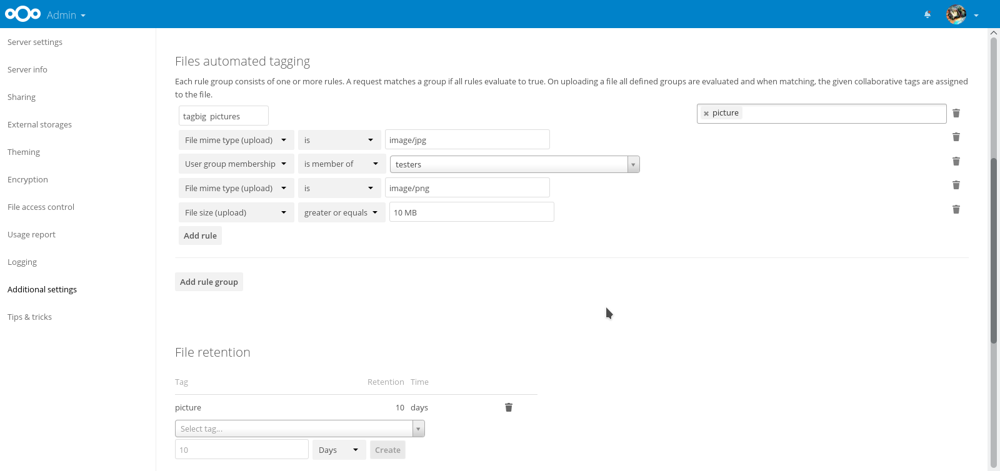

# Automated tagging of files for Nextcloud Flow

The Automated file tagging app adds a **Tag a file** operation to Nextcloud Flow. It automatically assigns collaborative tags to files and folders that match configured rules.

The tags can later be used to control retention, file access, automatic script execution and more.

## How it works

Administrators can configure rule groups in the Flow settings; users can also create personal flows when enabled. Each group combines its rules with AND: the group matches only when all its rules match. Every matching group assigns its configured tag. Criteria include MIME type, user group membership, request time, and upload size.

For example, a rule group can assign a restricted "Protected file" tag to items inside a folder marked with a "Protect content" tag. The restricted tag can then be used by File access control or retention rules. Administrators can use restricted or invisible tags; non-admin users can select only tags they can see and assign.

## Considerations

* Rules are evaluated for eligible file-cache insertions and updates, not only uploads. Changes made directly on external storage can be evaluated when Nextcloud discovers them.
* Adding or changing a rule does not itself retag existing files. Tags already assigned are not automatically removed when a rule stops matching.
* The file-size criterion depends on upload request headers and may not match in other contexts.
* User group criteria check the current user, not the file owner. Without an authenticated user, "is" does not match and "is not" matches.
* Do not rely on automatic tagging for the roots of external storage mounts or group folders; assign their initial tags manually.

See the [automated tagging documentation](https://docs.nextcloud.com/server/stable/go.php?to=admin-files-automated-tagging) for configuration details.
